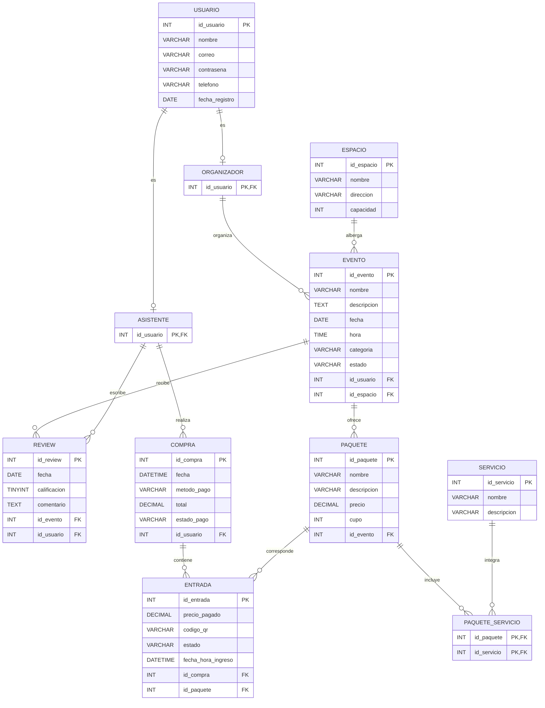

# Modelo relacional y proceso de normalización

## Sistema de gestión de eventos

**Universidad Industrial de Santander**  
Escuela de Ingeniería de Sistemas e Informática

**Asignatura:** Bases de Datos I  
**Docente:** Ing. Nury Farelo  
**Entrega:** Segunda entrega – Octubre de 2026

---

## 1. Introducción

Este documento presenta el modelo relacional de nuestro sistema de gestión de eventos y el proceso de normalización que seguimos para llegar a la forma normal adecuada. En el sistema los usuarios pueden participar como organizadores o como asistentes. Los organizadores crean eventos en un espacio determinado y los eventos ofrecen paquetes, que a su vez incluyen servicios. Los asistentes realizan compras, de las cuales salen las entradas, y además pueden dejar reseñas sobre los eventos.

Para el análisis partimos del modelo E-R de la primera entrega y de lo visto en clase sobre normalización (Farelo, s. f.; Teoría de la normalización, 2003–2004). Normalizamos hasta la tercera forma normal (3FN), que es la que se considera suficiente para un diseño correcto y la que pide el curso. No llegamos a FNBC porque ninguna de las tablas tiene varias claves candidatas compuestas que compartan atributos, así que en este caso la FNBC sería equivalente a la 3FN.

## 2. Cambios respecto al modelo E-R

El modelo E-R se mantiene igual en entidades, atributos y relaciones. Los únicos ajustes tienen que ver con el paso al modelo relacional:

- La especialización de **USUARIO** en **ORGANIZADOR** y **ASISTENTE** se convirtió en tres tablas. Cada subtipo toma como clave primaria el `id_usuario`, que al mismo tiempo es clave foránea hacia **USUARIO**.
- La relación muchos a muchos entre **PAQUETE** y **SERVICIO** (**INCLUYE**) se resolvió con la tabla **PAQUETE_SERVICIO**, con clave primaria compuesta.
- El atributo de **ENTRADA** se llama `fecha_hora_ingreso`, igual que en el E-R, para diferenciarlo de la fecha de la compra.
- Se agregaron los tipos de dato y las restricciones de cada columna, que no estaban en la primera entrega.

## 3. Proceso de normalización paso a paso

Como el E-R ya estaba bastante separado, para mostrar el proceso lo hicimos como si todo estuviera guardado en una sola tabla de eventos, que es el punto de partida que se usa en el ejemplo visto en clase. A partir de ahí se aplican las tres formas normales de manera sucesiva. En las tablas, las claves primarias están marcadas con **(PK)** y las foráneas con **(FK)**.

### 3.1 Punto de partida: relación sin normalizar

Toda la información estaría en una sola relación, con los grupos que se repiten indicados entre llaves:

```text
EventoGeneral (
    id_evento, nombre, descripcion, fecha, hora, categoria, estado,
    datos del organizador [
        id_usuario, nombre, correo, contraseña, telefono, fecha_registro
    ],
    datos del espacio [
        id_espacio, nombre, direccion, capacidad
    ],
    {paquetes:
        id_paquete, nombre, descripcion, precio, cupo,
        {servicios: id_servicio, nombre, descripcion}
    },
    {entradas:
        id_entrada, precio_pagado, codigo_qr, estado, fecha_hora_ingreso,
        datos de la compra [
            id_compra, fecha, metodo_pago, total, estado_pago
        ],
        datos del asistente
    },
    {reviews:
        id_review, fecha, calificacion, comentario, datos del asistente
    }
)
```

La clave sería `id_evento`. Aquí se ve que un evento tiene varios paquetes, cada paquete varios servicios, y que además hay varias entradas y varias reseñas por evento. Todos esos son grupos repetitivos que no caben en una sola fila.

### 3.2 Primera forma normal (1FN)

Una relación está en 1FN cuando todos sus atributos tienen un solo valor atómico. Para lograrlo, los grupos repetitivos se pasan a tablas nuevas que traen consigo la clave de la tabla de origen, tal como se hizo con los teléfonos y autores en el ejemplo de clase. Quedan cinco relaciones:

| Relación | Atributos |
|---|---|
| **Evento** (PK: `id_evento`) | `id_evento`, `nombre`, `descripcion`, `fecha`, `hora`, `categoria`, `estado`, `id_usuario`, `nombre_organizador`, `correo_organizador`, `contraseña_organizador`, `telefono_organizador`, `fecha_registro_organizador`, `id_espacio`, `nombre_espacio`, `direccion_espacio`, `capacidad_espacio` |
| **Paquete** (PK: `id_evento`, `id_paquete`) | `id_evento`, `id_paquete`, `nombre_paquete`, `descripcion_paquete`, `precio`, `cupo` |
| **PaqueteServicio** (PK: `id_paquete`, `id_servicio`) | `id_paquete`, `id_servicio`, `nombre_servicio`, `descripcion_servicio` |
| **Entrada** (PK: `id_entrada`) | `id_entrada`, `precio_pagado`, `codigo_qr`, `estado`, `fecha_hora_ingreso`, `id_paquete`, `id_compra`, `fecha_compra`, `metodo_pago`, `total`, `estado_pago`, `id_asistente`, `nombre_asistente`, `correo_asistente`, `contraseña_asistente`, `telefono_asistente`, `fecha_registro_asistente` |
| **Review** (PK: `id_review`) | `id_review`, `fecha`, `calificacion`, `comentario`, `id_evento`, `id_asistente`, `nombre_asistente`, `correo_asistente`, `contraseña_asistente`, `telefono_asistente`, `fecha_registro_asistente` |

El teléfono se maneja como un solo valor por usuario, tal como está en el E-R, por lo que no hace falta una tabla aparte para teléfonos. Si el sistema llegara a permitir varios teléfonos por usuario, ahí sí se tendría que separar, como en el ejemplo de clase.

### 3.3 Segunda forma normal (2FN)

Una relación está en 2FN si está en 1FN y todos los atributos que no son clave dependen de la clave completa y no solo de una parte. Esto solo hay que revisarlo en las relaciones con clave compuesta, que aquí son Paquete y PaqueteServicio:

- En **Paquete**, los atributos `nombre`, `descripcion`, `precio` y `cupo` dependen únicamente de `id_paquete`, no de `id_evento`. Como un paquete pertenece a un solo evento, `id_paquete` basta como clave primaria e `id_evento` queda como clave foránea.
- En **PaqueteServicio**, `nombre_servicio` y `descripcion_servicio` dependen solo de `id_servicio`. Se mueven a una tabla nueva, **Servicio**, y **PaqueteServicio** queda solo con las dos claves.

Las demás relaciones tienen clave simple, así que ya cumplen 2FN. El resultado de este paso es:

| Relación | Atributos |
|---|---|
| **Evento** (PK: `id_evento`) | Igual que en 1FN |
| **Paquete** (PK: `id_paquete`) | `id_paquete`, `nombre`, `descripcion`, `precio`, `cupo`, `id_evento` (FK) |
| **Servicio** (PK: `id_servicio`) | `id_servicio`, `nombre`, `descripcion` |
| **PaqueteServicio** (PK: `id_paquete`, `id_servicio`) | `id_paquete` (FK), `id_servicio` (FK) |
| **Entrada** (PK: `id_entrada`) | Igual que en 1FN |
| **Review** (PK: `id_review`) | Igual que en 1FN |

### 3.4 Tercera forma normal (3FN)

Una relación está en 3FN si está en 2FN y ningún atributo no clave depende de otro atributo no clave (dependencias transitivas). Al revisar las relaciones aparecen estos casos:

- En **Evento**, los datos del organizador dependen de `id_usuario` y los del espacio dependen de `id_espacio`, no de `id_evento`. Se separan en las tablas **Usuario** y **Espacio**.
- En **Entrada**, los datos de la compra (`fecha`, `metodo_pago`, `total`, `estado_pago`) dependen de `id_compra`, y los datos del asistente dependen de `id_asistente`. Los primeros pasan a la tabla **Compra** y los segundos a **Usuario**.
- En **Review**, los datos del asistente también dependen de `id_asistente`, así que se eliminan de la tabla y quedan en **Usuario**.

Como los organizadores y los asistentes son usuarios con los mismos datos personales, se dejan los datos en una sola tabla **Usuario**, y los roles se representan con las tablas **Organizador** y **Asistente**, cuya clave primaria es el `id_usuario`. De esta forma **Evento** referencia a **Organizador**, y **Compra** y **Review** referencian a **Asistente**. Con esto se llega a las 11 tablas del modelo final, que aparecen en la siguiente sección.

### 3.5 Resumen de la verificación

| Tabla | 1FN | 2FN | 3FN | Justificación |
|---|:---:|:---:|:---:|---|
| USUARIO | Sí | Sí | Sí | Clave simple; los atributos dependen solo de `id_usuario` |
| ORGANIZADOR | Sí | Sí | Sí | Solo tiene la clave |
| ASISTENTE | Sí | Sí | Sí | Solo tiene la clave |
| ESPACIO | Sí | Sí | Sí | Nombre, dirección y capacidad dependen de `id_espacio` |
| EVENTO | Sí | Sí | Sí | Guarda solo las referencias al organizador y al espacio |
| REVIEW | Sí | Sí | Sí | Guarda solo las referencias al evento y al asistente |
| COMPRA | Sí | Sí | Sí | Depende de `id_compra`; el asistente es solo referencia |
| PAQUETE | Sí | Sí | Sí | Depende de `id_paquete`; el evento es solo referencia |
| ENTRADA | Sí | Sí | Sí | Depende de `id_entrada`; compra y paquete son referencias |
| SERVICIO | Sí | Sí | Sí | Nombre y descripción dependen de `id_servicio` |
| PAQUETE_SERVICIO | Sí | Sí | Sí | Clave compuesta sin atributos adicionales |

## 4. Modelo relacional normalizado

La Figura 1 muestra el modelo relacional final. Las claves primarias se marcan con **PK** y las foráneas con **FK**.


*Figura 1. Modelo relacional normalizado del sistema de gestión de eventos.*

**Representación del modelo en Mermaid** (editable en visores compatibles):



### 4.1 Tablas, tipos de dato y restricciones

Los tipos de dato están pensados para un gestor SQL estándar (como MySQL o PostgreSQL). Los valores permitidos de las columnas de estado, categoría y método de pago son los que propusimos para el proyecto y se controlan con restricciones `CHECK`.

#### Tabla 1. USUARIO

| Columna | Tipo de dato | Restricciones |
|---|---|---|
| `id_usuario` | `INT` | PK, autoincremental |
| `nombre` | `VARCHAR(100)` | NOT NULL |
| `correo` | `VARCHAR(100)` | NOT NULL, UNIQUE |
| `contraseña` | `VARCHAR(255)` | NOT NULL (se guarda cifrada) |
| `telefono` | `VARCHAR(20)` | Puede ser nulo |
| `fecha_registro` | `DATE` | NOT NULL |

#### Tabla 2. ORGANIZADOR

| Columna | Tipo de dato | Restricciones |
|---|---|---|
| `id_usuario` | `INT` | PK, FK → USUARIO |

#### Tabla 3. ASISTENTE

| Columna | Tipo de dato | Restricciones |
|---|---|---|
| `id_usuario` | `INT` | PK, FK → USUARIO |

#### Tabla 4. ESPACIO

| Columna | Tipo de dato | Restricciones |
|---|---|---|
| `id_espacio` | `INT` | PK, autoincremental |
| `nombre` | `VARCHAR(100)` | NOT NULL |
| `direccion` | `VARCHAR(150)` | NOT NULL |
| `capacidad` | `INT` | NOT NULL, CHECK (`capacidad > 0`) |

#### Tabla 5. EVENTO

| Columna | Tipo de dato | Restricciones |
|---|---|---|
| `id_evento` | `INT` | PK, autoincremental |
| `nombre` | `VARCHAR(100)` | NOT NULL |
| `descripcion` | `TEXT` | Puede ser nulo |
| `fecha` | `DATE` | NOT NULL |
| `hora` | `TIME` | NOT NULL |
| `categoria` | `VARCHAR(50)` | NOT NULL |
| `estado` | `VARCHAR(20)` | NOT NULL, CHECK (Programado, En curso, Finalizado, Cancelado) |
| `id_usuario` | `INT` | FK → ORGANIZADOR, NOT NULL |
| `id_espacio` | `INT` | FK → ESPACIO, NOT NULL |

#### Tabla 6. REVIEW

| Columna | Tipo de dato | Restricciones |
|---|---|---|
| `id_review` | `INT` | PK, autoincremental |
| `fecha` | `DATE` | NOT NULL |
| `calificacion` | `TINYINT` | NOT NULL, CHECK (entre 1 y 5) |
| `comentario` | `TEXT` | Puede ser nulo |
| `id_evento` | `INT` | FK → EVENTO, NOT NULL |
| `id_usuario` | `INT` | FK → ASISTENTE, NOT NULL |

#### Tabla 7. COMPRA

| Columna | Tipo de dato | Restricciones |
|---|---|---|
| `id_compra` | `INT` | PK, autoincremental |
| `fecha` | `DATETIME` | NOT NULL |
| `metodo_pago` | `VARCHAR(30)` | NOT NULL, CHECK (Tarjeta, PSE, Transferencia, Efectivo) |
| `total` | `DECIMAL(12,2)` | NOT NULL, CHECK (`total >= 0`) |
| `estado_pago` | `VARCHAR(20)` | NOT NULL, CHECK (Pendiente, Pagado, Rechazado, Reembolsado) |
| `id_usuario` | `INT` | FK → ASISTENTE, NOT NULL |

#### Tabla 8. PAQUETE

| Columna | Tipo de dato | Restricciones |
|---|---|---|
| `id_paquete` | `INT` | PK, autoincremental |
| `nombre` | `VARCHAR(100)` | NOT NULL |
| `descripcion` | `VARCHAR(255)` | Puede ser nulo |
| `precio` | `DECIMAL(12,2)` | NOT NULL, CHECK (`precio >= 0`) |
| `cupo` | `INT` | NOT NULL, CHECK (`cupo >= 0`) |
| `id_evento` | `INT` | FK → EVENTO, NOT NULL |

#### Tabla 9. ENTRADA

| Columna | Tipo de dato | Restricciones |
|---|---|---|
| `id_entrada` | `INT` | PK, autoincremental |
| `precio_pagado` | `DECIMAL(12,2)` | NOT NULL, CHECK (`precio_pagado >= 0`) |
| `codigo_qr` | `VARCHAR(255)` | NOT NULL, UNIQUE |
| `estado` | `VARCHAR(20)` | NOT NULL, CHECK (Disponible, Usada, Anulada) |
| `fecha_hora_ingreso` | `DATETIME` | Nulo hasta que la entrada se use |
| `id_compra` | `INT` | FK → COMPRA, NOT NULL |
| `id_paquete` | `INT` | FK → PAQUETE, NOT NULL |

#### Tabla 10. SERVICIO

| Columna | Tipo de dato | Restricciones |
|---|---|---|
| `id_servicio` | `INT` | PK, autoincremental |
| `nombre` | `VARCHAR(100)` | NOT NULL |
| `descripcion` | `VARCHAR(255)` | Puede ser nulo |

#### Tabla 11. PAQUETE_SERVICIO

| Columna | Tipo de dato | Restricciones |
|---|---|---|
| `id_paquete` | `INT` | PK compuesta, FK → PAQUETE |
| `id_servicio` | `INT` | PK compuesta, FK → SERVICIO |

## 5. Claves foráneas y relaciones

La cardinalidad se lee desde la tabla referenciada hacia la tabla que contiene la clave foránea.

| Clave foránea | Referencia a | Cardinalidad |
|---|---|---|
| `ORGANIZADOR.id_usuario` | `USUARIO.id_usuario` | 1 a 0..1 |
| `ASISTENTE.id_usuario` | `USUARIO.id_usuario` | 1 a 0..1 |
| `EVENTO.id_usuario` | `ORGANIZADOR.id_usuario` | 1 a N |
| `EVENTO.id_espacio` | `ESPACIO.id_espacio` | 1 a N |
| `REVIEW.id_usuario` | `ASISTENTE.id_usuario` | 1 a N |
| `REVIEW.id_evento` | `EVENTO.id_evento` | 1 a N |
| `COMPRA.id_usuario` | `ASISTENTE.id_usuario` | 1 a N |
| `PAQUETE.id_evento` | `EVENTO.id_evento` | 1 a N |
| `ENTRADA.id_compra` | `COMPRA.id_compra` | 1 a N |
| `ENTRADA.id_paquete` | `PAQUETE.id_paquete` | 1 a N |
| `PAQUETE_SERVICIO.id_paquete` | `PAQUETE.id_paquete` | 1 a N |
| `PAQUETE_SERVICIO.id_servicio` | `SERVICIO.id_servicio` | 1 a N |

Aunque algunas claves foráneas se llaman `id_usuario`, no apuntan a la tabla **USUARIO** sino a los subtipos. `EVENTO.id_usuario` referencia a **ORGANIZADOR**, y `REVIEW.id_usuario` y `COMPRA.id_usuario` referencian a **ASISTENTE**. Así queda garantizado que solo un organizador pueda crear eventos y que solo un asistente pueda comprar o escribir reseñas.

### Especialización de USUARIO

Cada registro de **ORGANIZADOR** o **ASISTENTE** corresponde a exactamente un usuario, mientras que un usuario puede tener cero o un registro en cada subtipo. Por eso, en la notación de pata de cuervo, el símbolo de «exactamente uno» queda del lado de **USUARIO** y el de «cero o uno» del lado del subtipo. Al ser el `id_usuario` la clave primaria de cada subtipo, un mismo usuario no puede repetirse dentro de un rol.

## 6. Decisiones de diseño

### Precio del paquete y precio pagado

`PAQUETE.precio` es el precio vigente del paquete, mientras que `ENTRADA.precio_pagado` es lo que realmente se pagó por esa entrada. Los dos se conservan porque pueden ser distintos si el precio del paquete cambia después de la compra o si hubo un descuento. Por esa razón `id_paquete` no determina el `precio_pagado` y no hay una dependencia transitiva.

### Total de la compra

El atributo `total` ya estaba en el E-R y se conserva. Si se define como la suma de los `precio_pagado` de las entradas de la compra, es un dato calculable, y por eso hay que mantenerlo consistente con ellas. Guardarlo no rompe por sí solo la 3FN, pero obliga a recalcularlo cada vez que se agreguen, anulen o modifiquen entradas de la compra. Esto se puede resolver calculándolo al cerrar la compra o con un trigger. Si más adelante el total incluye cargos o descuentos adicionales, esa regla tendrá que documentarse.

### Otras observaciones

- Tampoco se creó una tabla aparte para categoría o estado, porque por ahora son solo etiquetas sin atributos propios.
- El modelo no define si un usuario puede ser organizador y asistente a la vez ni si debe tener al menos un rol. Con la estructura actual ambas cosas son posibles, y si el equipo decide restringirlo habría que agregar reglas adicionales.

## 7. Conclusión

El modelo final tiene 11 tablas que cumplen la primera, segunda y tercera forma normal. En el proceso los grupos repetitivos se separaron en tablas propias (1FN), se eliminaron las dependencias parciales de las claves compuestas (2FN) y se quitaron las dependencias transitivas, dejando los datos de usuarios, espacios y compras en sus propias tablas (3FN). Cada tabla guarda información de una sola entidad, lo que evita redundancia y reduce las anomalías de inserción, borrado y modificación.

Como pendiente queda confirmar las reglas de negocio mencionadas, en especial la forma de calcular el total de la compra y los valores permitidos en las columnas de estado, categoría y método de pago.

## Referencias

Farelo, N. (s. f.). *Ejemplo normalización* [Diapositivas de clase]. Bases de Datos I, Ingeniería de Sistemas, Universidad Industrial de Santander.

*Teoría de la normalización*. (2003–2004). *Tema 6 de Bases de Datos – Biblioteconomía* [Material de clase].
